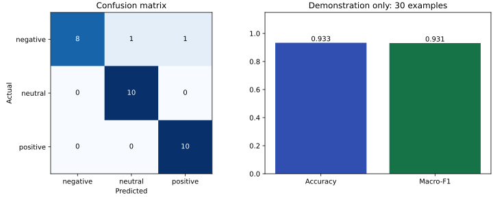

# Анализ тональности русского текста

Учебное приложение определяет **положительную, нейтральную или отрицательную**
тональность короткого русского текста. Пользователь вводит текст в браузере,
а готовая нейросеть [RuBERT-tiny sentiment balanced](https://huggingface.co/cointegrated/rubert-tiny-sentiment-balanced)
выбирает один из трёх классов. Есть также HTTP API и Swagger UI.

Приложение использует готовые веса Hugging Face через Transformers и PyTorch.
**Обучение собственной модели не входит в текущую версию.** GPU, API-ключи,
регистрация и загрузка обучающего корпуса не нужны.

## Быстрый запуск

Требования: Python **3.10–3.12**, [uv](https://docs.astral.sh/uv/), интернет при
первой установке зависимостей и загрузке модели.

```bash
uv sync --frozen
uv run uvicorn main:app --host 127.0.0.1 --port 8000
```

Откройте **http://127.0.0.1:8000/**, введите текст и нажмите «Оценить тональность».
Например: `Мне очень понравилось, всё отлично!`.

- Интерфейс приложения: http://127.0.0.1:8000/
- Интерактивная документация: http://127.0.0.1:8000/docs
- Контракт OpenAPI, генерируемый из кода: http://127.0.0.1:8000/openapi.json

При первом запуске Transformers скачает модель, затем будет использовать кеш
Hugging Face (`~/.cache/huggingface/hub`, если не задан `HF_HOME`). Загрузка
происходит до начала обработки запросов. Для воспроизводимости версия модели
зафиксирована в [config.py](sentiment_app/config.py), зависимости — в `uv.lock`.

## Что умеет приложение

- Принимает текст от 1 до 5000 символов, убирает пробелы по краям.
- Возвращает `positive`, `neutral` или `negative`; интерфейс переводит метки на русский.
- Загружает модель один раз при старте и выполняет предсказания на CPU.
- Показывает ошибку ввода или соединения в интерфейсе.
- Не сохраняет тексты и историю запросов. Вычисления выполняются локально.

Вход длиннее лимита токенизатора обрезается, даже если укладывается в 5000 символов.
Лимит символов служит для валидации запроса; он не означает, что модель обработает
весь текст. Нейтральная метка означает класс модели, а не отсутствие ошибок.
Сарказм, сложные отрицания и смешанные эмоции могут распознаваться неверно.

## Где что находится

```text
main.py                       # короткая точка входа uvicorn
sentiment_app/
  application.py              # создание FastAPI, загрузка/освобождение модели, страница /
  config.py                   # корень проекта, имя и revision модели
  api/
    schemas.py                # проверка текста и схема JSON-ответа
    routes.py                 # HTTP-маршрут POST /sentiment
  models/
    pretrained.py             # загрузка токенизатора и весов, одиночный/пакетный инференс
  web/
    index.html                # форма ввода и область результата
    style.css                 # оформление и адаптация для узкого экрана
    app.js                    # запрос к API, отображение ответа и ошибок
evaluation/
  examples.csv                # 30 вручную составленных демонстрационных примеров
  run.py                      # проверка модели, accuracy, macro-F1, матрица ошибок
  plots.py                    # построение графика по сохранённому JSON
tests/                        # автоматические проверки без скачивания модели
docs/
  report.md                   # пояснительная записка по семи пунктам PDF
  project-plan.md             # план, зависимости, роли, диаграммы и подготовка защиты
  tasks.csv                   # задачи для переноса в систему планирования
  figures/quality.svg         # график качества на демонстрационных примерах
artifacts/
  pretrained.metrics.json     # фактические предсказания и метрики готовой модели
pyproject.toml                # зависимости и параметры pytest
uv.lock                       # зафиксированные версии зависимостей
```

Для изменения внешнего вида начните с `web/`; для изменения ограничений ввода —
с `api/schemas.py`; для выбора другой модели — с `config.py` и проверки её
классов в `models/pretrained.py`. Для анализа ошибок откройте JSON в `artifacts/`.

Путь запроса: **браузер → routes.py → schemas.py → pretrained.py → ответ → браузер**.
Обучение и хранение пользовательских текстов не выполняются.

## API

### `POST /sentiment`

```bash
curl -X POST http://127.0.0.1:8000/sentiment \
  -H 'Content-Type: application/json' \
  -d '{"text": "Мне очень понравилось, всё отлично!"}'
```

Ответ HTTP 200 имеет вид:

```json
{"sentiment": "positive"}
```

Конкретная метка определяется моделью. Возможные значения: `negative`, `neutral`,
`positive`. Обязательное поле `text` должно быть строкой длиной 1–5000 символов
после удаления пробелов по краям. Пустой ввод, число вместо строки, отсутствие
`text` и превышение длины возвращают **HTTP 422** с описанием ошибки в `detail`.

Необязательный параметр `?model=pretrained` оставлен для совместимости.
`?model=custom` возвращает 422, `/compare` удалён (404): своей модели в приложении нет.
Аутентификация для локальной учебной демонстрации не требуется.

## Проверка качества и график

```bash
uv run python -m evaluation.run
uv run python -m evaluation.plots
```

Если модель уже в кеше и сеть не нужна:

```bash
uv run python -m evaluation.run --offline
```

Проверка использует 30 примеров из `evaluation/examples.csv`: по 10 на каждый
класс. Это вручную составленный **демонстрационный набор**, а не независимый
репрезентативный тест. Метрики описывают только эти примеры. CSV можно заменить
на собственный размеченный набор с колонками `text,label`:

```bash
uv run python -m evaluation.run --dataset /path/to/examples.csv --output artifacts/my.metrics.json
uv run python -m evaluation.plots --report artifacts/my.metrics.json --output docs/figures/my-quality.svg
```

Отчёт сохраняет метки, предсказания, accuracy, macro-F1, матрицу ошибок,
контрольную сумму CSV, имя и revision модели. График строится из отчёта, без
повторной загрузки модели. Matplotlib входит в группу зависимостей `dev`,
устанавливаемую `uv sync` по умолчанию.



Метрики и их ограничения разобраны в [пояснительной записке](docs/report.md).
Графиков обучения нет: веса взяты готовыми, обучение в проекте не проводилось.

## Автоматические проверки

```bash
uv run pytest -q
```

Тесты проверяют три класса ответа, валидацию, маршруты, интерфейс, контракт OpenAPI,
подсчёт метрик и загрузку приложения. В тестах API инференс заменён контролируемой
заглушкой: они проверяют поведение кода, а не качество модели. Проверка реальных
весов выполняется отдельно командой `evaluation.run`.

## Соответствие учебному заданию

| Требование | Где выполнено / что ещё нужно |
| --- | --- |
| Готовая библиотека машинного обучения | Hugging Face Transformers + PyTorch |
| Формулировка задачи и обзор | [Пояснительная записка](docs/report.md), разделы 1–3 |
| Данные, архитектура и метод обучения | Разделы 4–5; описана готовая модель, своё обучение не проводится |
| Оценка качества и графики | Раздел 6, `evaluation/`, отчёт и график |
| Итоги | Раздел 7 пояснительной записки |
| План на 01.10–31.10.2026, зависимости, роли | [План проекта](docs/project-plan.md), [задачи CSV](docs/tasks.csv) |
| Репозиторий, документация | Этот проект и README; изменения необходимо опубликовать в GitHub |
| Команда, таблица тем, план в системе | Заполнить участниками и ссылками; локальные документы подготовлены как шаблон |
| Защита и сдача ссылок | Сценарий и чек-лист в конце плана проекта |

План обозначен как проектный: он не подтверждает, что работы фактически
выполнялись в указанные даты. Имена участников, название команды, запись в таблице
тем и скриншот из выбранной системы планирования должны быть реальными.

## Если что-то не запускается

- **Не скачивается модель:** проверьте доступ к Hugging Face и интернет. Без
  предварительно загруженного кеша первый запуск офлайн невозможен.
- **Страница недоступна:** дождитесь завершения загрузки модели в терминале;
  проверьте порт и адрес сервера.
- **Порт 8000 занят:** запустите с `--port 8001` и откройте соответствующий адрес.
- **Python 3.13 и выше:** выберите Python 3.12, например `uv sync --python 3.12`.
- **Не найден matplotlib:** выполните `uv sync --group dev`.

## Источники

- [Карточка модели: классы, применение и сведения об обучении](https://huggingface.co/cointegrated/rubert-tiny-sentiment-balanced).
- [Документация Transformers](https://huggingface.co/docs/transformers/).
- [Документация PyTorch](https://pytorch.org/docs/stable/).
- [Документация FastAPI](https://fastapi.tiangolo.com/).
