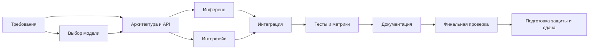
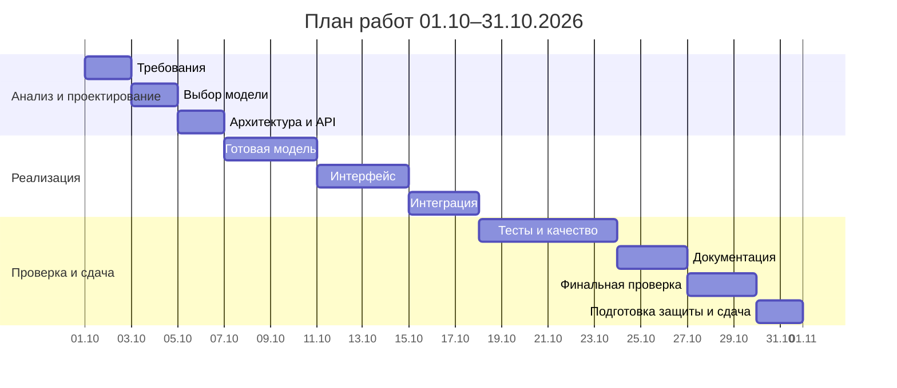

# План проекта и подготовка защиты

Период работ: **01.10.2026–31.10.2026**. **Дедлайн сдачи — 31 октября 2026 года.** Ниже — проектный план, а не журнал
фактически выполненных работ. Все работы по проекту выполнил Гайдай Андрей Юрьевич.
Перед сдачей необходимо перенести задачи в выбранную систему и приложить её реальный скриншот.

## Исполнитель и роли

| Поле | Значение |
| --- | --- |
| Формат выполнения | Индивидуально |
| Исполнитель всех работ | Гайдай Андрей Юрьевич |
| Scrum-master | Гайдай Андрей Юрьевич |
| Аналитик / документация | Гайдай Андрей Юрьевич |
| Разработчик ML-интеграции | Гайдай Андрей Юрьевич |
| Разработчик интерфейса / API | Гайдай Андрей Юрьевич |
| Тестировщик | Гайдай Андрей Юрьевич |
| Таблица тем проектов | Ссылка на запись команды |
| Система планирования | Название и ссылка на проект |
| Репозиторий | https://github.com/andrgayday/software_engineering |

Все роли совмещал Гайдай Андрей Юрьевич: координация проекта, анализ требований,
интеграция модели, разработка интерфейса и API, тестирование и документация.
Роли используются для описания видов работ одного исполнителя.

## Этапы, зависимости и результаты

Работы запланированы последовательно, поскольку исполнитель один.
Длительность указана в календарных днях включительно. В CSV зависимости записаны
идентификаторами; при нескольких зависимостях используются пробелы.

| ID | Этап | Даты | Дни | Зависит от | Ответственный | Результат |
| --- | --- | --- | ---: | --- | --- | --- |
| P1 | Знакомство с задачей, требования | 01.10–02.10 | 2 | — | Гайдай Андрей Юрьевич | Задача, сценарии, критерии приёмки |
| P2 | Обзор библиотек, выбор модели | 03.10–04.10 | 2 | P1 | Гайдай Андрей Юрьевич | Выбранная модель, классы и ограничения |
| P3 | Архитектура, интерфейс, API | 05.10–06.10 | 2 | P1 P2 | Гайдай Андрей Юрьевич | Структура модулей и контракт |
| P4 | Подключение готовой модели | 07.10–10.10 | 4 | P3 | Гайдай Андрей Юрьевич | Локальный инференс |
| P5 | Пользовательский интерфейс | 11.10–14.10 | 4 | P3 | Гайдай Андрей Юрьевич | Форма и вывод результата |
| P6 | Интеграция и обработка ошибок | 15.10–17.10 | 3 | P4 P5 | Гайдай Андрей Юрьевич | Работающее приложение |
| P7 | Тесты, оценка качества, графики | 18.10–23.10 | 6 | P6 | Гайдай Андрей Юрьевич | Тесты, отчёт с метриками, график |
| P8 | README и пояснительная записка | 24.10–26.10 | 3 | P7 | Гайдай Андрей Юрьевич | Документация и ограничения |
| P9 | Финальная проверка и исправления | 27.10–29.10 | 3 | P8 | Гайдай Андрей Юрьевич | Проверенный запуск по README |
| P10 | Подготовка защиты и сдача | 30.10–31.10 | 2 | P9 | Гайдай Андрей Юрьевич | Демонстрация, ссылки и скриншот |

В P1–P3 выполняются анализ и проектирование, в P4–P6 — реализация и интеграция,
в P7–P9 — проверка и документирование, в P10 — подготовка защиты и сдача результата.
Своё обучение отсутствует; этап ML посвящён интеграции готовой модели.

## Сетевая диаграмма

## Временная диаграмма

## Распределение участия по этапам

Единственный исполнитель всех этапов — Гайдай Андрей Юрьевич.

| Участник | P1 | P2 | P3 | P4 | P5 | P6 | P7 | P8 | P9 | P10 |
| --- | --- | --- | --- | --- | --- | --- | --- | --- | --- | --- |
| Гайдай Андрей Юрьевич | ● | ● | ● | ● | ● | ● | ● | ● | ● | ● |

Ниже показано распределение видов работ по совмещаемым ролям:
● — основная работа, ○ — участие или проверка. Все роли выполняет тот же исполнитель.

| Роль | P1 | P2 | P3 | P4 | P5 | P6 | P7 | P8 | P9 | P10 |
| --- | --- | --- | --- | --- | --- | --- | --- | --- | --- | --- |
| Scrum-master | ○ | ○ | ○ | ○ | ○ | ○ | ○ | ○ | ○ | ● |
| Аналитик | ● | ○ | ○ | | ○ | | ○ | ● | ○ | ● |
| ML-разработчик | ○ | ● | ○ | ● | | ● | ● | ○ | ○ | ● |
| Интерфейс / API | ○ | | ● | ○ | ● | ● | ○ | ○ | ● | ● |
| Тестировщик | ○ | | ○ | | ○ | ○ | ● | ○ | ● | ● |

## Перенос в систему планирования

[Задачи в CSV](tasks.csv) содержат даты, длительности, зависимости, исполнителя, роли и критерии
готовности. Выберите систему с календарным планом или диаграммой Ганта, создайте
эти задачи, назначьте исполнителем Гайдая Андрея Юрьевича и проверьте видимость для преподавателя.
При отсутствии импорта перенесите строки вручную. Сделайте скриншот плана с датами
и участниками и приложите его к ответу на задание. Локальная Mermaid-диаграмма
сама по себе не заменяет требуемый скриншот выбранной системы.

## Критерии приёмки

- Приложение запускается по README в окружении Python 3.10–3.12.
- Пользователь получает один из трёх классов через интерфейс и API.
- Невалидный ввод отклоняется, ошибка объясняется пользователю.
- Готовая модель и её версия указаны; обучение не заявляется как выполненное.
- Тесты проходят; реальные предсказания и график воспроизводятся.
- Пояснительная записка содержит все семь разделов и ограничения оценки.

## Сценарий защиты

1. Гайдай Андрей Юрьевич представляет тему и перечисляет выполненные им работы.
2. Объясняет задачу, план, зависимости и совмещение ролей при индивидуальной работе.
3. Показывает структуру модулей и выбор готовой модели.
4. Демонстрирует позитивный, нейтральный и негативный текст, затем пустой ввод.
5. Показывает API `/docs`, метрики, график и примеры ошибок модели.
6. Объясняет ограничения и достигнутый результат.

Перед сдачей: внести тему в общую таблицу; опубликовать код в GitHub;
открыть преподавателю доступ; перенести план в систему; приложить ссылку на
репозиторий и реальный скриншот плана. Публикация и регистрация темы не
выполнялись автоматически.
